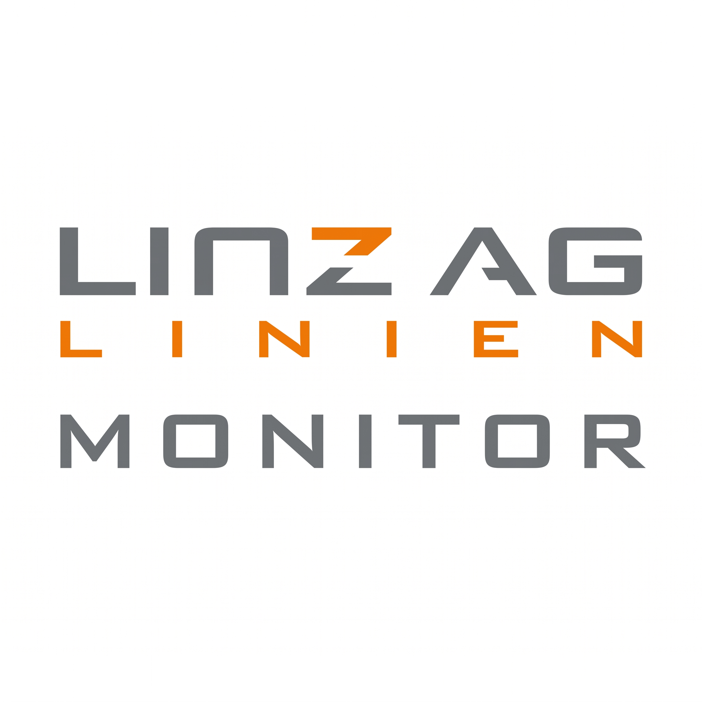
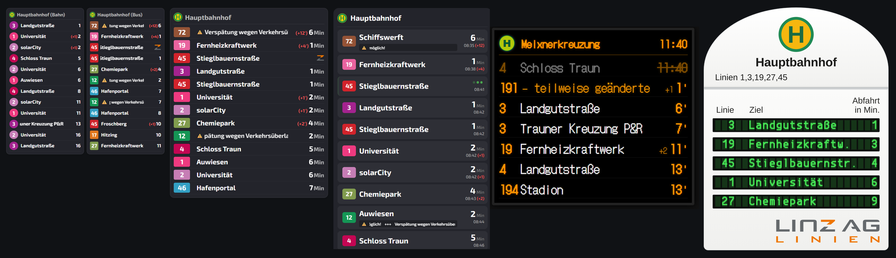
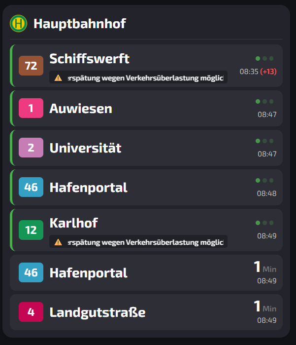
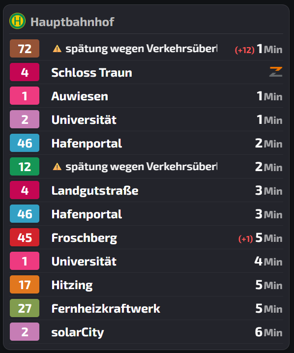
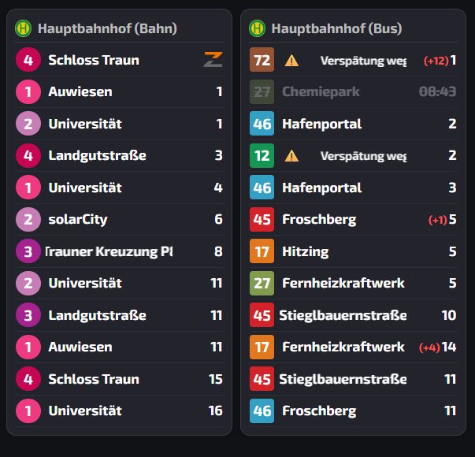
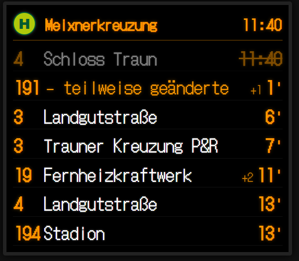
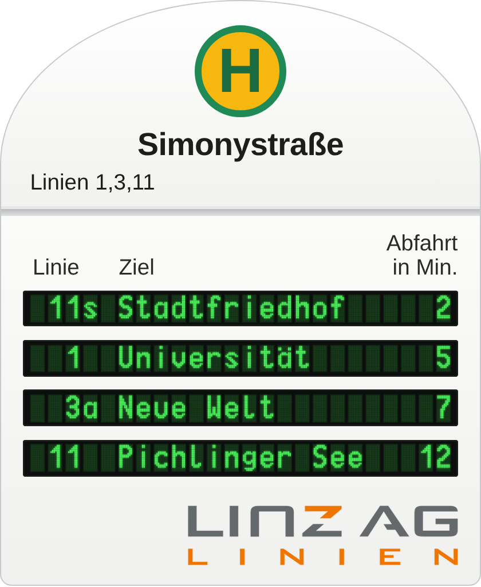
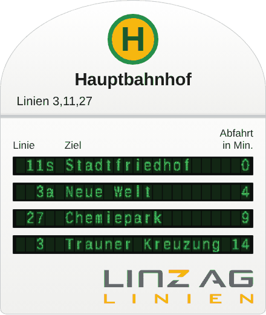

# 🚋 Linz Linien Abfahrtsmonitor

[](https://github.com/hacs/integration)
[]()
[]()
[](https://www.buymeacoffee.com/irmscher)





**Der moderne Abfahrtsmonitor für Home Assistant.**  
Live‑Daten der Linz AG Linien, smarte Einrichtung per Text- oder Kartensuche und hochgradig anpassbare Dashboard‑Karten.

---

## 🆕 Neu in v1.8.3
* **Haltestellen-Säule:** neue 5 × 7-LED-Schrift wie am Original (jeder Punkt doppelt), Kurznamen wie an der echten Anzeige (Fernheizwerk, Kleinmünchen, Trauner Kreuzung, Stieglbauernstr.) und feste 24-Felder-Zeilen wie am Original – Linie (Feld 1–3), Zusatz wie `a`, `*`, `s` (Feld 4), Ziel bzw. Sonderinformation (Feld 6–21, läuft bei Überlänge Feld für Feld durch), Abfahrtsminuten (Feld 22–24, max. 99 Minuten). Zusatzinfos wie „Verspätung bitte Geduld“ wechseln sich mit dem Ziel ab. 

## 🆕 Neu in v1.8.0
* **5. Design „Haltestellen-Säule“:** Originalgetreuer Nachbau der Linz AG Anzeige an der Haltestelle – H-Schild, Haltestellenname, Linien-Zeile und grüne LED-Zeilen mit fester 24-Felder-Matrix (feine Punkte, 8 × 14 pro Zeichen, Laufschrift für lange Ziele und Zusatzinfos) und Linz AG Linien Logo (nur die Tafel, ohne Mast). Das Logo wird lokal aus der Integration geladen.
* **Brand-Icons in korrekter Größe** (256/512 px) für eine scharfe Anzeige in HACS und Home Assistant.

## 🆕 Neu in v1.6.1
* **Linie 11s:** Fahrten der Linie 11 zum Stadtfriedhof werden als `11s` statt `11*` angezeigt.
* **Karte wird automatisch geladen** – kein manueller Ressourcen-Eintrag mehr nötig.
* **Stabiler & sicherer:** SSL-Zertifikatsprüfung aktiv, saubere Verbindungsfreigabe, kein doppeltes Anlegen derselben Haltestelle, Abfahrtsliste wird nicht mehr in die Verlaufsdatenbank geschrieben.
* **Bugfixes:** Haltestellennamen wie „Linzer Straße" werden nicht mehr verstümmelt; Änderungen im Karten-Editor (Zeilenhöhe, Schrift, LED-Farbe) wirken sofort; `hacs.json` repariert.

## 🚀 NEU in dieser Version
* **100% Live-API & Kartensuche:** Kein lokaler GTFS-Datenbank-Ballast mehr! Die Integration läuft nun komplett über die direkte Linz AG API, was sie extrem schnell und ressourcenschonend macht. Haltestellen können jetzt auch bequem über eine interaktive Umkreissuche (Karte) gefunden werden.
* **Vom Sensor zum "Gerät":** Pro Haltestelle wird nun ein echtes Home Assistant *Gerät (Device)* angelegt, das automatisch **5 übersichtliche Sensoren** für die nächsten 5 Abfahrten enthält.
* **Klartext-Anzeige:** Keine nackten Zahlen mehr! Sensoren zeigen direkt lesbaren Text (z.B. `1 Universität 14:30 (5 Min)` oder `3 Traun (Jetzt)`) – perfekt für Apple Watch oder kompakte Dashboards.
* **Saubere Namen & Duplikat-Filter:** Unerwünschte Zusätze wie *"Linz/Donau"* oder *"Leonding"* werden aus Zielen herausgefiltert. Die clevere Suche zeigt jede Haltestelle nur noch exakt einmal an.
* **Smartes Live-Sync:** Ein zentraler DataCoordinator aktualisiert die Echtzeitdaten exakt alle 60 Sekunden schonend für alle Sensoren gleichzeitig, ohne das API-Limit zu sprengen.

---

## ✨ Features

- ⚡ 100% Echtzeit‑Daten inkl. Verspätungen und Baustellen-Infos  
- 🔍 Smart Search für Haltestellen (Textsuche oder interaktive GPS-Umkreissuche)
- 🎨 Fünf Design‑Varianten (Maxi, Midi, Mini, LED Wall, Haltestellen-Säule) in einer einzigen flexiblen Karte zusammengeführt  
- 📱 Responsive: Perfekt für Tablets, Wallpanels & Smartphones  
- ⚙️ Komplette UI‑Konfiguration via Lovelace Editor

---

## ⚙️ Einrichtung — 1) Integration hinzufügen (wichtig: zuerst) 🚦

Bevor Sie Dashboard‑Karten nutzen, fügen Sie bitte zunächst die Integration hinzu.

1. Gehen Sie zu **Einstellungen** > **Geräte & Dienste** > **Integration hinzufügen**.  
2. Suchen Sie nach **Linz AG Monitor**.  
3. Wählen Sie zwischen der **klassischen Textsuche** oder der **interaktiven Kartensuche**.
4. Wählen Sie den korrekten Treffer aus dem Dropdown-Menü aus.  
5. **Fertig:** Sie haben nun ein neues *Gerät*, das 5 Sensoren enthält (z.B. `sensor.haltestelle_hauptbahnhof_nachste_abfahrt`, `sensor.haltestelle_hauptbahnhof_abfahrt_2`, etc.).

> **WICHTIG für das Dashboard:** Der Sensor **"Nächste Abfahrt"** (`sensor.haltestelle_ihre_station_nachste_abfahrt`) enthält im Hintergrund die unsichtbaren `departureList`-Attribute für die Custom Cards. Wählen Sie in den Lovelace-Karten immer diesen ersten Sensor aus!

---

## 📥 Dashboard‑Karten (Integriert) 🗂️

Die Custom Lovelace Card (`linz-linien-combined.js`) ist jetzt direkt in dieser Integration enthalten und wird **automatisch** geladen. Eine manuelle Installation der Karte oder ein separates Repository ist nicht mehr erforderlich!

*Hinweis zur Migration:* Falls Sie noch die alten separaten v1/v2/v3 JS-Dateien nutzen, entfernen Sie diese bitte aus Ihren Ressourcen und nutzen Sie ab sofort nur noch die neue kombinierte Karte.

---

## 🖼️ Vorschau der Layouts

| Design V1 (Maxi) | Design V2 (Midi) | Design V3 (Mini) | LED-Wall | Haltestellen-Säule |
| :---: | :---: | :---: | :---: | :---: |
|  |  |  |  |  |

---

## 🚏 Design 5: Haltestellen-Säule (DFI)

Originalgetreuer Nachbau der dynamischen Fahrgastinformation (DFI) an den Linz AG Haltestellen – nur die Tafel selbst, ohne Mast.

<p>
  
  &nbsp;&nbsp;
  
</p>

**So ist jede LED-Zeile aufgebaut – immer 24 gleich große Felder:**

| Feld | Inhalt | Beispiel |
| :---: | --- | --- |
| 1–3 | Liniennummer (rechtsbündig) | `11`, `3`, `N82` |
| 4 | Zusatzbezeichnung | `s`, `a`, `b`, `*` |
| 5 | leer | |
| 6–21 | Ziel bzw. Sonderinformation (16 Felder) | `Trauner Kreuzung` |
| 22–24 | Abfahrt in Minuten (rechtsbündig, max. 99) | `0` (blinkt), `5`, `12` |

* **Laufschrift:** Ist ein Ziel oder eine Information länger als 16 Felder, läuft der Text Feld für Feld nach links – mit kurzer Pause am Anfang und am Ende, damit jedes Wort lesbar ist.
* **Sonderinformationen** wie „Verspätung bitte Geduld“ oder „Fällt aus“ wechseln sich im Zielfeld mit dem Ziel ab.
* **Kurznamen wie an der echten Anzeige** (nur in diesem Design): Fernheizkraftwerk → *Fernheizwerk*, Remise Kleinmünchen → *Kleinmünchen*, Trauner Kreuzung P+R → *Trauner Kreuzung*, Stieglbauernstraße → *Stieglbauernstr.*
* **LED-Schrift wie am Original:** klassische 5 × 7-Punkt-Schrift, jeder Schrift-Punkt als 2 × 2 feine LED-Punkte gezeichnet – Striche 2 Punkte dick, inkl. Ä, Ö, Ü, ß.
* **Kopf:** H-Schild, Haltestellenname und Linien-Zeile (automatisch aus den Abfahrten oder selbst eingetragen).
* **Unten rechts** das Linz AG Linien Logo (wird lokal aus der Integration geladen), optional eine kleine Uhrzeit links.
* Wie an der echten Anzeige erscheinen nur Abfahrten bis 99 Minuten; die Anzeige ist immer in Minuten.
* Die Tafel passt sich der Kartenbreite an – vom Smartphone bis zum Wandtablet.

---

## ⚙️ Verwendung & Konfiguration im Dashboard

Eine Karte, fünf Varianten! Sie können die Karte komplett grafisch im Home Assistant UI-Editor anpassen (inklusive dynamischer Linien- und Richtungs-Filter per Klick!). 

Falls Sie den YAML-Modus bevorzugen, hier ein Beispiel für das kompakte **Midi-Layout**:

```yaml
type: custom:linz-monitor-combined
entity: sensor.haltestelle_hauptbahnhof_nachste_abfahrt
layout: midi
anzahl: 8
row_height: 38
font_size: 20
dest_size: 18
filter: "1,2"
sortierung: "echtzeit"
```

### Beispiel: Haltestellen-Säule

```yaml
type: custom:linz-monitor-combined
entity: sensor.haltestelle_hauptbahnhof_nachste_abfahrt
layout: stele
anzahl: 4                    # Anzahl der LED-Zeilen (wie am Original 3–4)
stele_led_color: "#4dff5e"   # Farbe der LED-Schrift
stele_clock: true            # kleine Uhrzeit unten links
stele_lines: ""              # Linien-Zeile, leer = automatisch (z.B. "27,41,43")
stele_footer_image: ""       # optional eigenes Bild statt Linz AG Logo unten rechts
```
