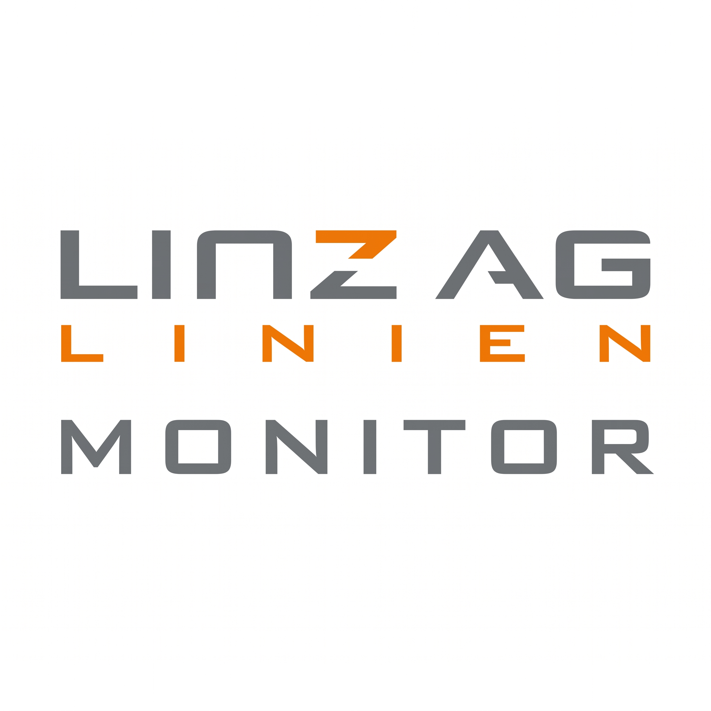
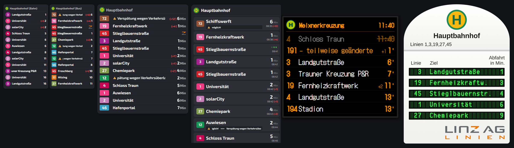
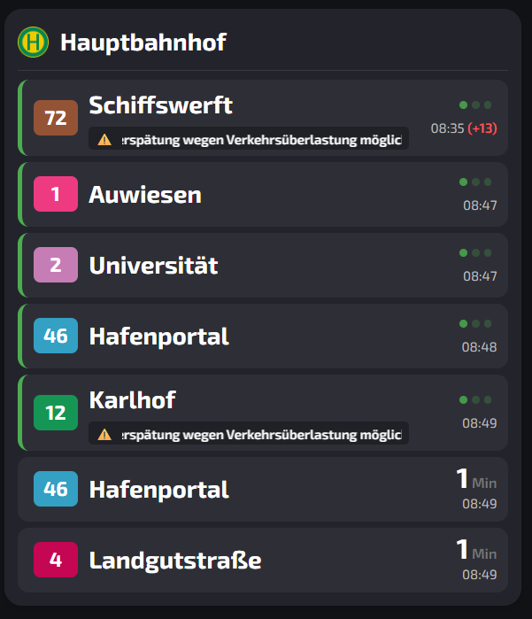
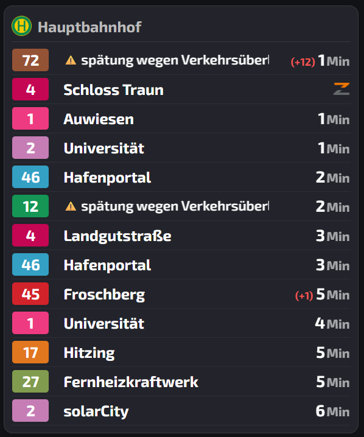
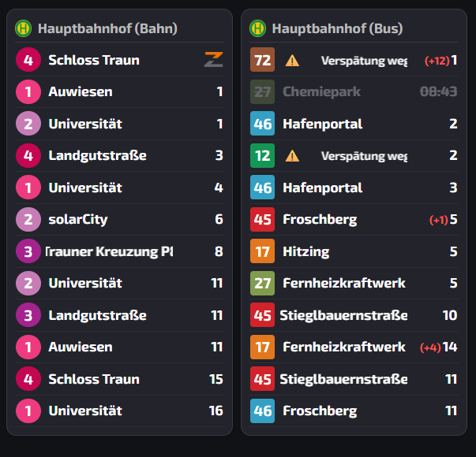
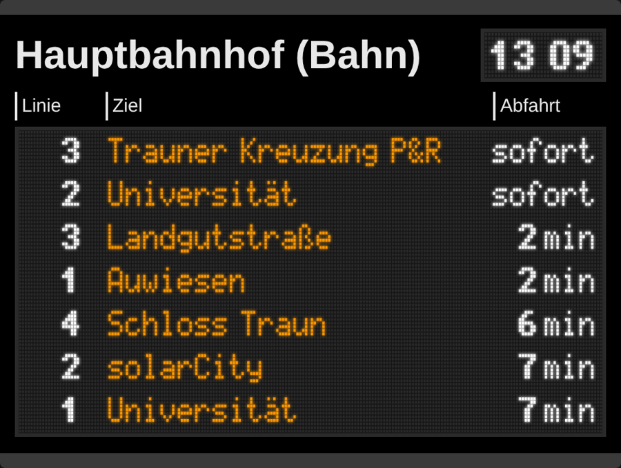
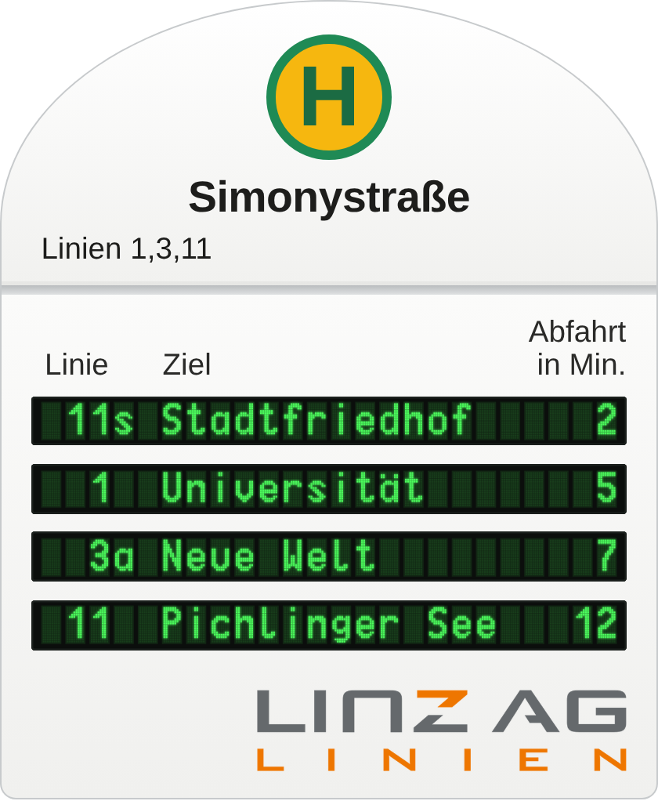
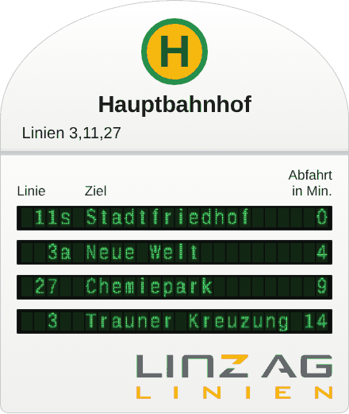
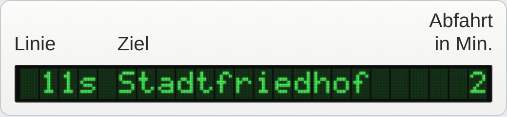

<div align="center">



# Linz Linien Abfahrtsmonitor

**Live-Abfahrten der Linz AG Linien für Home Assistant – mit fünf Anzeige-Designs,<br>vom kompakten Listen-Layout bis zum originalgetreuen Nachbau der Haltestellen-Anzeige.**

[](https://github.com/hacs/integration)
[](https://github.com/irmscher123/linz-linien-abfahrtsmonitor/releases)
[](https://github.com/irmscher123)



</div>

---

## Inhalt

1. [Auf einen Blick](#auf-einen-blick)
2. [Installation](#installation)
3. [Die fünf Designs](#die-fünf-designs)
   - [Maxi · Midi · Mini](#maxi--midi--mini)
   - [LED-Wall](#led-wall)
   - [Haltestellen-Säule](#haltestellen-säule)
4. [Für alle Designs](#für-alle-designs)
5. [Sensoren & Daten](#sensoren--daten)
6. [Konfiguration per YAML](#konfiguration-per-yaml)
7. [Alle Optionen](#alle-optionen)
8. [Häufige Fragen](#häufige-fragen)

---

## Auf einen Blick

|  |  |
| --- | --- |
| ⚡ **Live-Daten** | Echtzeit-Abfahrten direkt von der Linz AG – mit Verspätungen, Ausfällen und Hinweisen wie „Verspätung wegen Verkehrsüberlastung“ |
| 🔍 **Einfache Einrichtung** | Haltestelle per Textsuche oder auf der Karte auswählen |
| 🎨 **Fünf Designs** | Maxi, Midi, Mini, LED-Wall und Haltestellen-Säule – alles in einer Karte |
| 🖱️ **Ohne YAML** | Alles im Karten-Editor einstellbar, Linien und Richtungen per Klick filtern |
| 📦 **Alles inklusive** | Die Karte wird mit der Integration installiert und automatisch geladen |
| 🌡️ **Temperatur am Ort** | Temperatur an der Haltestelle – im LED-Fenster der LED-Wall und in der Info-Zeile der Säule |
| 🪶 **Schonend** | Ein Abruf pro Minute und Haltestelle, die lange Abfahrtsliste landet nicht im Verlauf |

---

## Installation

### 1 · Über HACS installieren

1. **HACS** öffnen → oben rechts **⋮** → **Benutzerdefinierte Repositories**.
2. `https://github.com/irmscher123/linz-linien-abfahrtsmonitor` eintragen, Typ **Integration**.
3. **Linz Linien Abfahrtsmonitor** suchen, installieren und **Home Assistant neu starten**.

### 2 · Haltestelle hinzufügen

1. **Einstellungen** → **Geräte & Dienste** → **Integration hinzufügen**.
2. Nach **Linz AG Monitor** suchen.
3. **Textsuche** oder **Kartensuche** wählen und die Haltestelle aus der Liste auswählen.

Für jede Haltestelle entsteht ein **Gerät mit 5 Sensoren** für die nächsten 5 Abfahrten. Weitere Haltestellen fügst du genauso hinzu.

### 3 · Karte ins Dashboard

Dashboard bearbeiten → **Karte hinzufügen** → **LinzAG Linien Monitor**.

Im Editor zuerst die **Haltestelle** wählen – das ist immer der Sensor **„Nächste Abfahrt“** (`sensor.<haltestelle>_nachste_abfahrt`), er enthält die komplette Abfahrtsliste. Danach Layout und Darstellung einstellen.

> **Updates:** Neue Versionen erscheinen in HACS. Nach dem Update den Browser neu laden (Strg + F5 bzw. App neu öffnen). Wenn sich die Integration selbst geändert hat, steht das in den Release-Notizen – dann zusätzlich Home Assistant neu starten.

---

## Die fünf Designs

| Maxi | Midi | Mini | LED-Wall | Haltestellen-Säule |
| :---: | :---: | :---: | :---: | :---: |
|  |  |  |  |  |
| `layout: maxi` | `layout: midi` | `layout: mini` | `layout: led` | `layout: stele` |

### Maxi · Midi · Mini

Die drei Listen-Layouts mit farbigen Linien-Badges in den Linz-AG-Farben.

- **Maxi** – große Zeilen mit Ziel, Minuten, geplanter Abfahrtszeit, Verspätung und Info-Zeile. Ideal für Wandtablets.
- **Midi** – kompakte Liste, Verspätung und Hinweise in einer Zeile. Zeilenhöhe und Schriftgrößen frei einstellbar.
- **Mini** – sehr platzsparend, für Smartphones oder als Seitenleiste. Badge-Größe und -Form einstellbar.

Abweichungen vom Fahrplan stehen neben der Zeit: Verspätung rot `(+4)`, Verfrühung blau `(−2)` – im Editor wählbar: beides, nur Verspätungen oder keine. Lange Hinweise laufen als Laufschrift durch. Ausgefallene Fahrten werden markiert und zeigen die reguläre Abfahrtszeit; ein vorhandener Hinweis läuft auch dann durch.

### LED-Wall


Eine Abfahrtstafel als echte Punktmatrix über die volle Kartenbreite.

- **Kopf:** Haltestellenname groß, Spaltenköpfe „Linie / Ziel / Abfahrt“ und ein kleines LED-Fenster oben rechts: Uhrzeit (8 s, Doppelpunkt blinkt), Datum und Temperatur am Ort der Haltestelle (je 3 s) im Wechsel – wie ein Kreisel: das Datum kommt von rechts, die Temperatur von unten, die Uhrzeit wieder von links. Oder nur die Uhrzeit.
- **Schrift:** Liniennummer und Abfahrt fett, Ziele ausgeschrieben in 5×7-Punktschrift – alles gleich hoch.
- **Abfahrt jetzt:** wahlweise „sofort“ oder zwei eng nebeneinander stehende Sterne, die im Sekundentakt abwechselnd blinken.
- **Abweichung vom Fahrplan** klein vor den Minuten, z. B. `+4` – rot bei Verspätung, blau bei Verfrühung. Wählbar: beides, nur Verspätungen oder keine.
- **Ab 60 Minuten** oder mit Zeitanzeige „Uhrzeit“ steht die Abfahrtszeit statt der Minuten.
- **Hinweise** wie „Verspätung! Bitte Geduld!“ laufen im Zielfeld von rechts herein, im Wechsel mit dem Ziel. Solange der Hinweis läuft, steht ein Warndreieck mit Rufzeichen davor – beim Ziel selbst nicht.
- **Keine Daten:** Liefert der Sensor keine Abfahrten, steht in den letzten beiden Zeilen „Keine Echtzeitdaten vorhanden!“ (weiß) und „Betrieb laut Fahrplanaushang!“ (LED-Farbe).
- **Ausfälle:** Statt der Minuten steht die reguläre Abfahrtszeit laut Fahrplan, ein vorhandener Hinweis läuft trotzdem durch. Die ganze Zeile leuchtet rot, das Ziel wechselt mit „Warndreieck + Fahrt fällt aus!“.
- **Farben frei wählbar:** Ziel, Linie & Abfahrt, Leisten oben/unten, Hintergrund sowie Name & Spaltenköpfe.
- Die frühere Darstellung bleibt unter **Darstellung → Klassisch** wählbar.

### Haltestellen-Säule

<p>
  
  &nbsp;&nbsp;
  
</p>

Originalgetreuer Nachbau der Anzeige an den Linz-AG-Haltestellen (DFI) – die Tafel selbst, ohne Mast. Mit H-Schild, Haltestellenname, Linien-Zeile, Spaltenköpfen und dem Linz AG Linien Logo.

**Jede LED-Zeile hat 24 gleich große Felder – wie am Original:**

| Feld | Inhalt | Beispiel |
| :---: | --- | --- |
| 1–3 | Liniennummer, rechtsbündig | `11`, `3`, `N82` |
| 4 | Zusatz | `s`, `a`, `b`, `*` |
| 5 | Abfahrt jetzt: blinkender Block ■ · Ausfall: Warndreieck mit Rufzeichen | |
| 6–21 | Ziel bzw. Hinweis (16 Felder) | `Trauner Kreuzung` |
| 22–24 | Minuten, rechtsbündig, max. 99 (bei Ausfall leer) | `5`, `12` |

**LED-Board wie am Original**

- Jedes Feld hat 8 × 16 LED-Plättchen, unbeleuchtete Plättchen schimmern leicht durch.
- Die LED-Schrift ist nach Fotos der echten Anzeige Plättchen für Plättchen abgezählt: 2 Plättchen dicke Striche, weiche Rundungen, Umlaute, ß und Sonderzeichen wie `/ * ( ) & ? %`.
- LED-Farbe frei wählbar.

**Verhalten wie an der Haltestelle**

- **Abfahrt jetzt:** Das Minutenfeld bleibt leer, vor dem Ziel blinkt ein kleiner Block.
- **Lange Ziele** laufen Feld für Feld durch, mit kurzer Pause am Anfang und Ende.
- **Hinweise** wie „Verspätung bitte Geduld“ laufen von rechts nach links durch, im Wechsel mit dem Ziel.
- **Ausfälle** bleiben bis zur geplanten Abfahrtszeit stehen: Warndreieck in Feld 5, das Minutenfeld bleibt leer, im Zielfeld wechseln Ziel, „Fahrt fällt aus!“ und ein vorhandener Hinweis (Laufschrift) – nichts wird durchgestrichen.
- Nur Abfahrten bis 99 Minuten, immer in Minuten.

**Kurznamen wie an der echten Anzeige** (nur in diesem Design)

| Ziel | Anzeige |
| --- | --- |
| Fernheizkraftwerk | Fernheizkraftw. |
| Remise Kleinmünchen | Kleinmünchen |
| Trauner Kreuzung P+R | Trauner Kreuzung |
| Stieglbauernstraße | Stieglbauernstr. |
| Wegscheider Straße | Wegscheider Str. |
| Volksgartenstraße | Volksgartenstr. |
| Sporthalle Leonding | Sporth. Leonding |

**Zusatzfunktionen**

- **Info-Zeile:** Die letzte Zeile zeigt Datum, Uhrzeit und Temperatur, z. B. `Sa 14.11.  14:05  -2,3°C`. Die Temperatur kommt automatisch vom Ort der Haltestelle – oder aus einer eigenen Wetter-Entität bzw. einem Temperatursensor. Statt der kleinen Uhrzeit unten links.
- **Jede Linie zuerst einmal:** Damit eine Bim im 3-Minuten-Takt die Busse nicht von der Tafel verdrängt, zeigt die Säule zuerst die nächste Abfahrt jeder Linie und füllt freie Zeilen auf – oder zeigt jede Linie nur einmal. Jede Richtung zählt extra.
- **Kompakt-Modus (Badge):** nur die LED-Zeilen, ohne Kopf und Logo – mit `anzahl: 1` eine einzeilige Anzeige.

  

---

## Für alle Designs

- **Filter nach Linien und Richtungen** – der Editor zeigt die Linien und Ziele der Haltestelle zum Anklicken. Nichts markiert = alles anzeigen.
- **Sortierung** nach Echtzeit (tatsächliche Abfahrt inkl. Verspätung) oder nach Fahrplan.
- **Zeitanzeige** in Minuten oder als Uhrzeit.
- **Eigener Name** für die Haltestelle statt des offiziellen.
- **Anzahl der Zeilen** frei wählbar.
- **Saubere Namen** – Zusätze wie „Linz/Donau“, „Leonding“ oder „Traun OÖ“ werden entfernt. Fahrten der Linie 11 zum Stadtfriedhof erscheinen als `11s`.
- **Passt sich an** – vom Smartphone bis zum Wandpanel.

---

## Sensoren & Daten

Pro Haltestelle legt die Integration ein Gerät mit 5 Sensoren an:

| Sensor | Inhalt |
| --- | --- |
| `…_nachste_abfahrt` | nächste Abfahrt als Klartext, z. B. `1 Universität 14:30 (5 Min)` oder `3 Traun (Jetzt)` – **für die Karte** |
| `…_abfahrt_2` bis `…_abfahrt_5` | die folgenden Abfahrten |

Der Sensor **„Nächste Abfahrt“** hat zusätzlich diese Attribute:

| Attribut | Inhalt |
| --- | --- |
| `departureList` | alle Abfahrten mit Linie, Ziel, Plan-Zeit, Minuten, Abweichung (`delay`: positiv = Verspätung, negativ = Verfrühung), Echtzeit, Ausfall und Hinweisen |
| `temperature` | Temperatur am Ort der Haltestelle (Open-Meteo, alle 10 Minuten) |
| `stop_name`, `stop_id` | Name und ID der Haltestelle |
| `last_update` | Zeit des letzten Abrufs |

Die Sensoren eignen sich auch für Automationen, Sprachausgabe oder die Smartwatch. Abgerufen wird einmal pro Minute; die Abfahrtsliste und die Temperatur werden nicht in den Verlauf geschrieben.

---

## Konfiguration per YAML

Alles geht im Editor – wer lieber YAML schreibt, findet hier Beispiele.

<details>
<summary><b>Midi</b></summary>

```yaml
type: custom:linz-monitor-combined
entity: sensor.haltestelle_hauptbahnhof_nachste_abfahrt
layout: midi
anzahl: 8
row_height: 38
font_size: 20
dest_size: 18
filter: "1,2"            # nur diese Linien
sortierung: echtzeit     # echtzeit | plan
```
</details>

<details>
<summary><b>LED-Wall</b></summary>

```yaml
type: custom:linz-monitor-combined
entity: sensor.haltestelle_hauptbahnhof_nachste_abfahrt
layout: led
anzahl: 6
led_color: "#ff9900"         # Ziel
led_num_color: "#ffffff"     # Linie und Abfahrt
led_bar_color: "#3a3a3a"     # Leisten oben und unten
led_bg_color: "#000000"      # Hintergrund
led_text_color: "#e8e8e8"    # Name und Spaltenköpfe
led_clock: true              # LED-Fenster oben rechts
led_clock_mode: ""           # "" = Uhrzeit/Datum/Temperatur im Wechsel, "time" = nur Uhrzeit
led_now: ""                  # "" = sofort, "stars" = zwei blinkende Sterne
# led_style: classic         # frühere Darstellung
```
</details>

<details>
<summary><b>Haltestellen-Säule</b></summary>

```yaml
type: custom:linz-monitor-combined
entity: sensor.haltestelle_hauptbahnhof_nachste_abfahrt
layout: stele
anzahl: 4                    # wie am Original 3–4 Zeilen
stele_led_color: "#4dff5e"
stele_labels: true           # Spaltenköpfe
stele_clock: false           # kleine Uhrzeit unten links
stele_info_row: true         # letzte Zeile: Datum, Uhrzeit, Temperatur
stele_temp_entity: ""        # "" = Temperatur am Ort der Haltestelle
stele_once: fill             # jede Linie zuerst einmal
stele_lines: ""              # Linien-Zeile im Kopf, leer = automatisch
stele_compact: false         # true = nur LED-Zeilen
```
</details>

---

## Alle Optionen

<details open>
<summary><b>Allgemein</b></summary>

| Option | Bedeutung | Standard |
| --- | --- | --- |
| `entity` | Sensor „Nächste Abfahrt“ der Haltestelle | – |
| `layout` | `maxi`, `midi`, `mini`, `led` oder `stele` | `led` |
| `anzahl` | Anzahl der Zeilen | `7` (Säule `4`) |
| `filter` | nur diese Linien, z. B. `"1,2,3"` | alle |
| `filter_direction` | nur diese Ziele, mit Komma getrennt | alle |
| `sortierung` | `echtzeit` oder `plan` | `echtzeit` |
| `time_format` | `countdown` (Minuten) oder `absolute` (Uhrzeit) | `countdown` |
| `stop_name_override` | eigener Name der Haltestelle | offizieller Name |
| `show_delay` | Abweichung vom Fahrplan: leer = Verspätung rot `(+4)` und Verfrühung blau `(−2)`, `late` = nur Verspätungen, `none` = keine (alle Designs außer Säule) | beides |
</details>

<details>
<summary><b>Maxi · Midi · Mini</b></summary>

| Option | Bedeutung | Standard |
| --- | --- | --- |
| `row_height` | Zeilenhöhe in Pixel | `38` (Mini `32`) |
| `font_size` | Schriftgröße der Zeit | `20` (Mini `14`) |
| `dest_size` | Schriftgröße des Ziels | `20` (Mini `14`) |
| `font_family` | Schriftart | `Exo 2` |
| `show_info` | Info-Zeile anzeigen (Maxi) | `true` |
| `badge_size` | Größe der Linien-Badges in Pixel (Mini) | `24` |
| `badge_round` | Badges rund statt eckig | `true` |

</details>

<details>
<summary><b>LED-Wall</b></summary>

| Option | Bedeutung | Standard |
| --- | --- | --- |
| `led_style` | leer = Punktmatrix, `classic` = frühere Darstellung | Punktmatrix |
| `led_color` | Farbe der Ziele | `#ff9900` |
| `led_num_color` | Farbe von Liniennummer und Abfahrt | `#ffffff` |
| `led_cancel_color` | Farbe ausgefallener Fahrten | `#ff3b30` |
| `led_bar_color` | Leisten oben und unten | `#3a3a3a` |
| `led_bg_color` | Hintergrund | `#000000` |
| `led_text_color` | Haltestellenname und Spaltenköpfe | `#e8e8e8` |
| `led_clock` | LED-Fenster oben rechts anzeigen | `true` |
| `led_clock_mode` | leer = Uhrzeit, Datum und Temperatur im Wechsel, `time` = nur Uhrzeit | Wechsel |
| `led_now` | Abfahrt jetzt: leer = „sofort“, `stars` = zwei blinkende Sterne | „sofort“ |
</details>

<details>
<summary><b>Haltestellen-Säule</b></summary>

| Option | Bedeutung | Standard |
| --- | --- | --- |
| `stele_led_color` | Farbe der LED-Schrift | `#4dff5e` |
| `stele_labels` | Spaltenköpfe „Linie / Ziel / Abfahrt in Min.“ | `true` |
| `stele_clock` | kleine Uhrzeit unten links | `true` |
| `stele_info_row` | letzte Zeile mit Datum, Uhrzeit und Temperatur (statt `stele_clock`) | `false` |
| `stele_temp_entity` | Temperatur: leer = am Ort der Haltestelle, `none` = keine, oder eine Entität wie `weather.forecast_home` | leer |
| `stele_once` | `fill` = jede Linie zuerst einmal, `only` = jede Linie nur einmal | leer |
| `stele_lines` | Text der Linien-Zeile im Kopf, z. B. `"27,41,43"` | automatisch |
| `stele_compact` | nur LED-Zeilen, ohne Kopf und Logo | `false` |
| `stele_footer_image` | eigenes Bild unten rechts statt Linz AG Logo | Logo |
</details>

---

## Häufige Fragen

<details>
<summary><b>„Custom element doesn't exist: linz-monitor-combined“</b></summary>

Die Karte wurde vom Browser noch nicht geladen. Browser neu laden (Strg + F5) bzw. die Home-Assistant-App schließen und neu öffnen. Hilft das nicht: Home Assistant neu starten.
</details>

<details>
<summary><b>Nach einem Update sieht die Karte noch alt aus</b></summary>

Der Browser zeigt noch die zwischengespeicherte Version – Strg + F5 bzw. App neu öffnen.
</details>

<details>
<summary><b>Die Temperatur in der Info-Zeile bleibt leer</b></summary>

Nach dem Update auf Version 2.2 oder neuer muss Home Assistant einmal neu gestartet werden. Danach erscheint das Attribut `temperature` im Sensor „Nächste Abfahrt“ – beim ersten Abruf kann es bis zu einer Minute dauern.
</details>

<details>
<summary><b>Die Karte zeigt keine Abfahrten</b></summary>

Im Editor muss der Sensor **„Nächste Abfahrt“** gewählt sein – nicht „Abfahrt 2“ bis „Abfahrt 5“. Sind Linien- oder Richtungsfilter gesetzt, alle Markierungen entfernen.
</details>

<details>
<summary><b>Ich habe noch die alten Karten v1 / v2 / v3 als Ressource eingetragen</b></summary>

Diese bitte unter **Einstellungen → Dashboards → Ressourcen** entfernen. Die kombinierte Karte ersetzt sie und wird automatisch geladen.
</details>

---

<div align="center">

Gefällt dir das Projekt?

[](https://www.buymeacoffee.com/irmscher)

</div>
