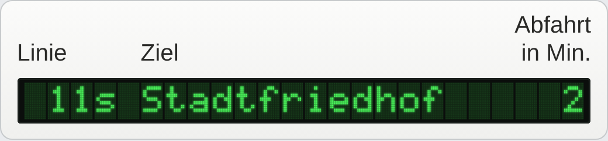

# 🚋 Linz Linien Abfahrtsmonitor

[](https://github.com/hacs/integration)
[]()
[]()
[](https://www.buymeacoffee.com/irmscher)


**Der moderne Abfahrtsmonitor für Home Assistant.**  
Live‑Daten der Linz AG Linien, Einrichtung per Text- oder Kartensuche und eine Dashboard‑Karte mit fünf Designs – vom kompakten Listen-Layout bis zum originalgetreuen Nachbau der Anzeige an der Haltestelle.

---

## ✨ Was die Integration kann

### 🔌 Integration
* **100 % Live-Daten direkt von der Linz AG** – Echtzeit-Abfahrten inkl. Verspätungen, Ausfällen und Sonderinformationen (z. B. „Verspätung wegen Verkehrsüberlastung“). Keine lokale Fahrplan-Datenbank nötig, schnell und ressourcenschonend.
* **Haltestellensuche per Text oder Karte** – klassisch nach Namen suchen oder auf einer interaktiven Karte im Umkreis eines Punktes. Jede Haltestelle erscheint nur einmal in der Trefferliste, und dieselbe Haltestelle kann nicht doppelt angelegt werden.
* **Ein Gerät pro Haltestelle mit 5 Sensoren** für die nächsten 5 Abfahrten – in lesbarem Klartext, z. B. `1 Universität 14:30 (5 Min)` oder `3 Traun (Jetzt)`. Ideal auch für Smartwatch, Sprachausgabe oder Automationen.
* **Saubere Ziel- und Haltestellennamen** – Zusätze wie „Linz/Donau“, „Leonding“ oder „Traun OÖ“ werden automatisch entfernt.
* **Linie 11s** – Fahrten der Linie 11 zum Stadtfriedhof werden als `11s` angezeigt (statt `11*`).
* **Schonende Aktualisierung** – ein zentraler Abruf alle 60 Sekunden für alle Sensoren einer Haltestelle, ohne das API-Limit der Linz AG zu belasten.
* **Sicher & sauber** – SSL-Zertifikatsprüfung aktiv; die lange Abfahrtsliste wird nicht in die Verlaufsdatenbank geschrieben.
* **Dashboard-Karte inklusive** – die Karte wird mit der Integration installiert und **automatisch geladen**. Kein manueller Ressourcen-Eintrag, kein zusätzliches Repository.

### 🎨 Dashboard-Karte – fünf Designs in einer Karte
| Design | Beschreibung |
| --- | --- |
| **Maxi** (V1) | Große Zeilen mit Linien-Badge, Ziel, Minuten, geplanter Abfahrtszeit, Verspätung und Info-Zeile – ideal für Wandtablets. |
| **Midi** (V2) | Kompakte Liste mit Verspätung und Hinweisen in einer Zeile – Zeilenhöhe und Schriftgrößen frei einstellbar. |
| **Mini** (V3) | Sehr platzsparend, perfekt für Smartphones oder als Seitenleiste. |
| **LED-Wall** | Klassische Anzeigetafel mit leuchtender LED-Schrift (Farbe frei wählbar), Uhrzeit und durchgestrichenen Ausfällen. |
| **Haltestellen-Säule** | Originalgetreuer Nachbau der dynamischen Fahrgastinformation (DFI) an den Linz AG Haltestellen – Details unten. |

Für alle Designs:
* **Komplett im UI-Editor einstellbar** – Layout, Anzahl der Zeilen, Schrift, Farben und mehr, ohne YAML.
* **Filter nach Linien und Richtungen per Klick** – der Editor zeigt die Linien und Ziele der Haltestelle zum Anhaken an.
* **Sortierung** nach Echtzeit (tatsächliche Abfahrt) oder nach Fahrplan.
* **Eigener Anzeigename** für die Haltestelle, Zeitanzeige in Minuten oder als Uhrzeit.
* **Responsive** – passt sich vom Smartphone bis zum Wandpanel an die Kartenbreite an.

---

## 🖼️ Vorschau der Layouts

| Design V1 (Maxi) | Design V2 (Midi) | Design V3 (Mini) | LED-Wall | Haltestellen-Säule |
| :---: | :---: | :---: | :---: | :---: |
|  |  |  |  |  |

---

## 🚏 Haltestellen-Säule (DFI)

Originalgetreuer Nachbau der Anzeige an den Linz AG Haltestellen – nur die Tafel selbst, ohne Mast.

<p>
  
  &nbsp;&nbsp;
  
</p>

**So ist jede LED-Zeile aufgebaut – immer 24 gleich große Felder wie am Original:**

| Feld | Inhalt | Beispiel |
| :---: | --- | --- |
| 1–3 | Liniennummer (rechtsbündig) | `11`, `3`, `N82` |
| 4 | Zusatzbezeichnung | `s`, `a`, `b`, `*` |
| 5 | leer – bei Abfahrt „jetzt“ blinkt hier ein Block ■ | |
| 6–21 | Ziel bzw. Sonderinformation (16 Felder) | `Trauner Kreuzung` |
| 22–24 | Abfahrt in Minuten (rechtsbündig, max. 99, bei „jetzt“ leer) | `5`, `12` |

* **LED-Board wie am Original:** jedes Feld hat 8 × 16 LED-Plättchen, die unbeleuchteten Plättchen schimmern leicht durch. LED-Schrift nach Fotos der echten Anzeige abgezählt: Striche 2 Plättchen dick, weiche Schrägen, Großbuchstaben und Ziffern 14 Plättchen hoch – inkl. Ä, Ö, Ü, ß und Sonderzeichen wie `/ * ( ) & ? %`. LED-Farbe frei wählbar.
* **Abfahrt „jetzt“:** Das Minutenfeld bleibt leer, stattdessen blinkt vor dem Ziel ein kleiner Block – ohne Zusatztext.
* **Laufschrift:** Ist ein Ziel länger als 16 Felder, läuft es Feld für Feld durch – mit kurzer Pause am Anfang und Ende, damit jedes Wort lesbar bleibt.
* **Sonderinformationen** wie „Verspätung bitte Geduld“ wechseln sich mit dem Ziel ab und laufen als Laufschrift von rechts nach links durch.
* **Ausfälle:** Die Fahrt bleibt bis zur geplanten Abfahrtszeit stehen – Ziel und Minuten durchgestrichen, dazwischen läuft „Fahrt fällt aus“.
* **Kurznamen wie an der echten Anzeige** (nur in diesem Design):

  | Ziel | Anzeige |
  | --- | --- |
  | Fernheizkraftwerk | Fernheizkraftw. |
  | Remise Kleinmünchen | Kleinmünchen |
  | Trauner Kreuzung P+R | Trauner Kreuzung |
  | Stieglbauernstraße | Stieglbauernstr. |
  | Wegscheider Straße | Wegscheider Str. |
  | Volksgartenstraße | Volksgartenstr. |
  | Sporthalle Leonding | Sporth. Leonding |

* Wie am Original nur Abfahrten bis 99 Minuten, immer in Minuten.
* **Info-Zeile (optional):** die letzte LED-Zeile zeigt Datum, Uhrzeit und Temperatur, z. B. `Sa 14.11.  14:05  -2,3°C`. Die Temperatur kommt automatisch vom Ort der Haltestelle (Open-Meteo, alle 10 Minuten, steht auch als Attribut `temperature` im Sensor „Nächste Abfahrt“) – oder auf Wunsch aus einer eigenen Wetter-Entität (`weather.*`) bzw. einem Temperatursensor. Statt der kleinen Uhrzeit unten links (beides zusammen geht nicht).
* **Jede Linie zuerst einmal (optional):** Damit Linien mit dichtem Takt (z. B. Bim alle 3 Minuten) seltene Linien (Bus alle 30 Minuten) nicht von der Tafel verdrängen, zeigt die Säule zuerst die nächste Abfahrt jeder Linie und füllt freie Zeilen mit weiteren Abfahrten auf – oder zeigt jede Linie nur einmal. Fährt eine Linie in beide Richtungen ab, zählt jede Richtung extra.
* **Kopf:** H-Schild, Haltestellenname und Linien-Zeile (automatisch aus den Abfahrten oder selbst eingetragen), darunter die Spaltenköpfe „Linie / Ziel / Abfahrt in Min.“ (ausblendbar).
* **Unten rechts** das Linz AG Linien Logo (lokal aus der Integration geladen, durch ein eigenes Bild ersetzbar), optional eine kleine Uhrzeit links.
* **Kompakt-Modus (Badge):** nur die LED-Zeile(n), ohne Kopf und Logo – mit `anzahl: 1` eine einzeilige Anzeige:

  

---

## ⚙️ Einrichtung

### 1) Installation über HACS
1. HACS öffnen → **Benutzerdefinierte Repositories** → `https://github.com/irmscher123/linz-linien-abfahrtsmonitor` als **Integration** hinzufügen.
2. **Linz Linien Abfahrtsmonitor** installieren und Home Assistant neu starten.

### 2) Haltestelle hinzufügen (zuerst!)
1. **Einstellungen** → **Geräte & Dienste** → **Integration hinzufügen**.
2. Nach **Linz AG Monitor** suchen.
3. **Textsuche** oder **Kartensuche** wählen.
4. Den passenden Treffer aus der Liste auswählen.
5. **Fertig:** Es gibt nun ein neues *Gerät* mit 5 Sensoren (z. B. `sensor.haltestelle_hauptbahnhof_nachste_abfahrt`, `sensor.haltestelle_hauptbahnhof_abfahrt_2` …).

> **Wichtig für das Dashboard:** Der Sensor **„Nächste Abfahrt“** (`sensor.haltestelle_<name>_nachste_abfahrt`) enthält die komplette Abfahrtsliste (`departureList`) für die Karte. Wählen Sie in der Karte immer diesen Sensor aus.

### 3) Karte ins Dashboard
Dashboard bearbeiten → **Karte hinzufügen** → **LinzAG Linien Monitor** auswählen und im Editor einstellen. Die Karte wird automatisch geladen.

*Umstieg von alten Versionen:* Falls noch die alten separaten Karten-Dateien (v1/v2/v3) als Ressource eingetragen sind, diese bitte entfernen – es wird nur noch die kombinierte Karte benötigt.

---

## 🧩 Konfiguration per YAML

Alles lässt sich im UI-Editor einstellen. Wer YAML bevorzugt:

### Beispiel: Midi-Layout

```yaml
type: custom:linz-monitor-combined
entity: sensor.haltestelle_hauptbahnhof_nachste_abfahrt
layout: midi            # maxi | midi | mini | led | stele
anzahl: 8
row_height: 38
font_size: 20
dest_size: 18
filter: "1,2"           # nur diese Linien
sortierung: "echtzeit"  # echtzeit | plan
```

### Beispiel: Haltestellen-Säule

```yaml
type: custom:linz-monitor-combined
entity: sensor.haltestelle_hauptbahnhof_nachste_abfahrt
layout: stele
anzahl: 4                    # Anzahl der LED-Zeilen (wie am Original 3–4)
stele_led_color: "#4dff5e"   # Farbe der LED-Schrift
stele_clock: true            # kleine Uhrzeit unten links
stele_lines: ""              # Linien-Zeile, leer = automatisch (z.B. "27,41,43")
stele_footer_image: ""       # optional eigenes Bild statt Linz AG Logo unten rechts
stele_compact: false         # true = nur LED-Zeilen (Badge), ohne Kopf und Logo
stele_labels: true           # Spaltenköpfe "Linie / Ziel / Abfahrt in Min." anzeigen
stele_info_row: false        # true = letzte Zeile mit Datum, Uhrzeit und Temperatur (statt stele_clock)
stele_temp_entity: ""        # leer = Temperatur am Ort der Haltestelle, "none" = keine, oder z.B. weather.forecast_home
stele_once: ""               # "fill" = jede Linie zuerst einmal, "only" = jede Linie nur einmal
```

### Wichtige Optionen

| Option | Bedeutung |
| --- | --- |
| `entity` | Sensor „Nächste Abfahrt“ der Haltestelle |
| `layout` | `maxi`, `midi`, `mini`, `led` oder `stele` |
| `anzahl` | Anzahl der angezeigten Abfahrten |
| `filter` | nur bestimmte Linien, z. B. `"1,2,3"` |
| `filter_direction` | nur bestimmte Ziele/Richtungen |
| `sortierung` | `echtzeit` (tatsächliche Abfahrt) oder `plan` (Fahrplan) |
| `stop_name_override` | eigener Anzeigename der Haltestelle |
| `time_format` | `countdown` (Minuten) oder `absolute` (Uhrzeit) |
| `led_color` | LED-Farbe der LED-Wall |
| `stele_*` | Optionen der Haltestellen-Säule (siehe Beispiel oben) |
